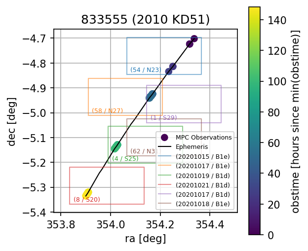

# deep-db: A Database of Moving Objects for the DECam Ecliptic Exploration Project (DEEP)

`deep-db` is a Python project for building and querying a database of moving objects in the DECam images taken for the DECam Ecliptic Exploration Project (DEEP).



# Installation

```bash
$ python -m pip install git+https://github.com/stevenstetzler/deep-db
```

# Data Sources

This database has four principal data sources:
1) The survey geometry of the DEEP imaging survey, downloaded from the [NOIRLab](https://datalab.noirlab.edu/) archive and stored as an exposure table in `ecsv` format in `data/exposures_object_raw.ecsv`. In addition, a curated field list is stored in `data/field_table.ecsv`. 
2) The Minor Planet Center database, accessed via an Small Body Node Postgres replica. The observation database is queried and filtered for observations belonging to this survey: by definition those with MPC station code `W84` and with observation times matching the exposures belonging to DEEP.
3) The local `mpchecker` ephemeris service made available via the `jOrbit` package ([MPChecker](https://jorbit.readthedocs.io/en/latest/basic/mpchecker.html)). The ephemeris service is used to query for positions of MPC designated objects at the midpoint of the DEEP exposure observation times.
4) Synthetic objects generated by [@bernardinelli](https://github.com/bernardinelli) via the [DESTNOSIM](https://github.com/bernardinelli/DESTNOSIM/) package. The original source files aren't made available in this repository due to their size; however, the relevant information is stored in a published version of the `deep-db` database.

## CLI Examples

The Python package comes with a command-line interface which is the main entrypoint into the database. The `deep-db query` command is likely the main command that will be useful to the end-user:
```
$ deep-db query --help
Usage: deep-db query [OPTIONS] COMMAND [ARGS]...

Options:
  --help  Show this message and exit.

Commands:
  fakes
  fakes-ephemeris
  object-ephemeris
  objects
  observations
  survey
```
which lets one query the database for the `survey` geometry, the `observations` submitted to the Minor Planet Center (MPC), the MPC-designated `objects` this survey has observed, the survey `fakes`, and the locations (ephemeris / ephemerides) of the `objects` and `fakes` at the exposure times.

For example to get the set of survey nights:
```
$ deep-db query survey night | head -n 5
20190401
20190402
20190403
20190504
20190505
```

To get the set of MPC-designated objects in one of those nights:
```
$ deep-db query objects provid --night 20190401 | head -n 5
2019 GT205
2025 ND510
2025 OY293
2019 GA179
2019 GS178
```

And to get the ephemeris of one of those objects:
```
$ deep-db query object-ephemeris Exposure.obstime MPCheckerEphemeris.ra MPCheckerEphemeris.dec -
-night 20190401 --provid '2019 GA179'
2019-04-02 05:06:18.382875|215.5635902024823|-13.383243916144291
2019-04-02 05:08:50.857950|215.5633638070001|-13.382999174050177
2019-04-02 05:11:20.439030|215.5631416476191|-13.382759039577335
2019-04-02 09:25:24.085429|215.54046543207332|-13.358089194658467
2019-04-02 09:27:52.175854|215.54024741155277|-13.357847755564332
2019-04-02 09:30:20.946189|215.54002847997143|-13.357605179704908
2019-04-02 09:33:27.396769|215.53975422623958|-13.357301124956853
```

Or to get the survey nights for which one of those objects has MPC submitted observations:
```
$ deep-db query survey night --provid '2019 GA179' --join mpc_observation
20190401
20190402
```

and for which it has a predicted location:
```
$ deep-db query survey night --provid '2019 GA179' --join mpchecker_ephemeris
20190401
20190402
20190403
```

The `deep-db visualize` command is also helpful for visualizing the ephemeris and observed locations of the moving objects, with the survey geometry (projected sky locations of the images) overlaid:
```
$ deep-db visualize --help
Usage: deep-db visualize [OPTIONS] COMMAND [ARGS]...

Options:
  --help  Show this message and exit.

Commands:
  known-objects
  synthetic-objects

$ deep-db visualize known-objects --help
Usage: deep-db visualize known-objects [OPTIONS]

Options:
  --provid TEXT     Unpacked MPC provisional designation
  --permid TEXT     MPC permanent designation
  --name TEXT       MPC object name
  --night INTEGER   Survey night (e.g. 20190402)
  --field TEXT      Survey field name (e.g. A0a)
  --expnum INTEGER  Exposure number
  --detnum INTEGER  Detector number
  --detname TEXT    Detector name
  --plot-ccds       Outline the CCDs the observations landed on, labeled by
                    (night, field)
  --annotate-ccds   Label each CCD box with its detector (implies --plot-ccds)
  --output TEXT     Path to save the figure to (shows interactively if
                    omitted)
  --help            Show this message and exit.
```

For example, to create the image included in this README:
```
$ deep-db visualize known-objects --provid '2010 KD51' --output data/2010_KD51.png --plot-ccds --annotate-ccds
```

## The Database

The moving object database is stored in a SQLite file, which is automatically downloaded from a remote server. It is stored in a cache directory on your computer. If you wish to re-create or query the database from another location, you can set the `DEEP_DB` environment variable to a valid SQLAlchemy connection string and utilize the `deep-db {database,fetch,ingest}` commands to create the database, ingest the survey geometry from the `data/exposures_object_raw.ecsv` (DEEP exposure table) and the `data/field_table.ecsv` (DEEP observing field table).
